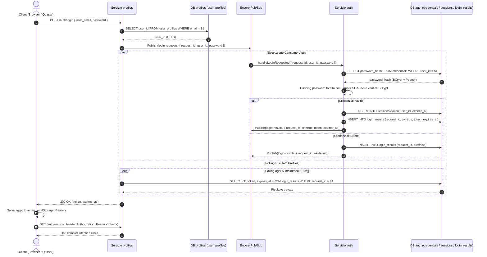
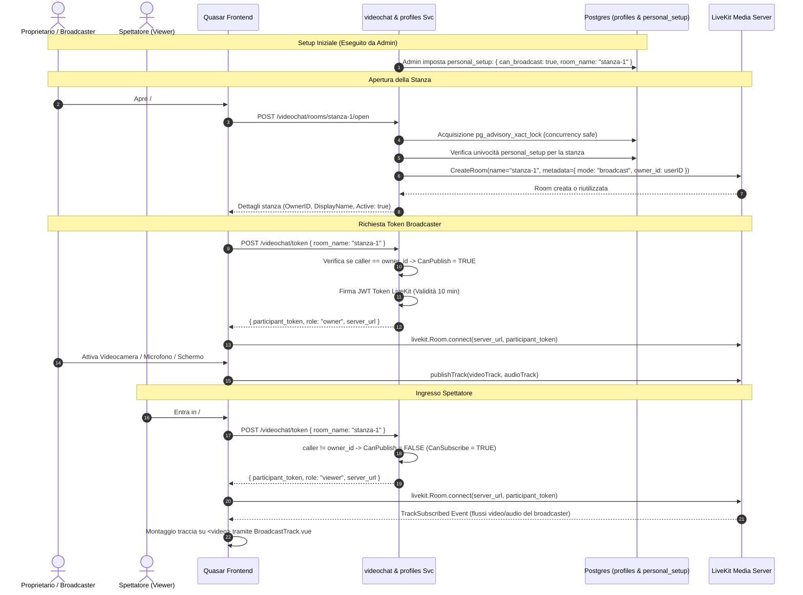
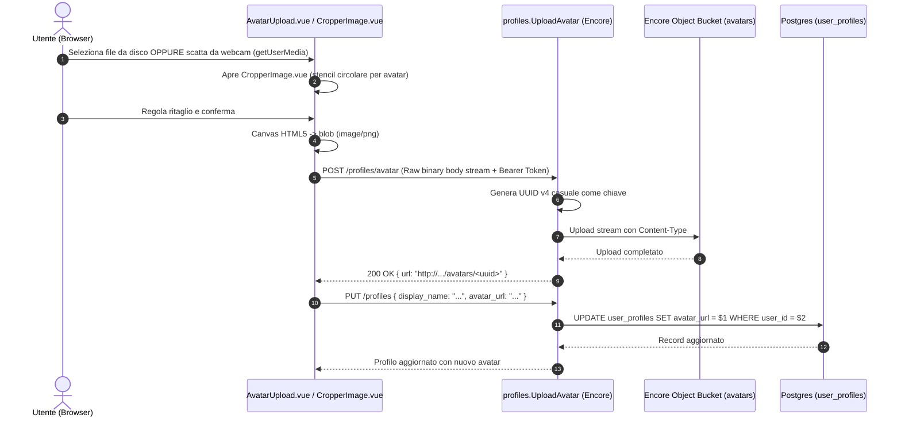

# Architettura di Sistema e Flussi Globali

Questo documento fornisce una visione d'insieme dell'architettura dell'intero sistema **Extra**, evidenziando i pattern di comunicazione tra Frontend (Quasar SPA) e Backend (Encore Microservices), le scelte architetturali di sicurezza, i flussi asincroni Pub/Sub e l'integrazione di servizi terzi come LiveKit.

---

## 1. Topologia Architetturale

L'applicazione segue un paradigma a **microservizi modulari** lato backend e un'interfaccia a **Single Page Application (SPA)** reattiva lato frontend.

```mermaid
graph TB
    subgraph Frontend["Frontend (Quasar Framework v2 / Vue 3 / TS)"]
        UI["Interfaccia Utente & Pagine Quasar"]
        Pinia["Pinia Stores (Profiles, Admin, Images, Layout)"]
        ClientTS["Encore Generated Client (HTTP/REST)"]
        LKClient["LiveKit Client SDK (WebRTC)"]
        UI --> Pinia
        Pinia --> ClientTS
        UI --> LKClient
    end

    subgraph Backend["Backend Encore (Go Microservices)"]
        Gateway["Encore API Gateway (Port 4000)"]
        AuthHandler["AuthHandler (//encore:authhandler)"]

        subgraph Services["Microservizi"]
            AuthSvc["auth (Credenziali, Sessioni, Hashing)"]
            ProfilesSvc["profiles (Utenti, Profili, Personal Setup)"]
            AdminSvc["admin (Backoffice, Middleware RequireAdmin)"]
            VideochatSvc["videochat (LiveKit Room & Token Manager)"]
            AdvSvc["advertising (Directory Inserzionisti & Promo)"]
            ImagesSvc["images (Catalogo & Binary Storage)"]
            RegSvc["registration (Orchestrazione Registrazione & Token)"]
            MailsSvc["mails (Outbox & Transactional Delivery)"]
            HomeSvc["extrahome (Configurazione Sito, Caroselli)"]
            HelloSvc["hello (Healthcheck & Test)"]
        end

        subgraph EventBus["Pub/Sub Event Broker"]
            LoginReq["Topic: login-requests"]
            LoginRes["Topic: login-results"]
        end

        subgraph Storage["Storage & Database"]
            PGAuth[("DB: auth")]
            PGProf[("DB: profiles")]
            PGAdv[("DB: advertising")]
            PGImg[("DB: images")]
            PGReg[("DB: registration")]
            PGHome[("DB: extrahome")]
            BucketAvatars["Bucket: avatars (Pubblico)"]
            BucketImages["Bucket: images (Pubblico)"]
        end
    end

    subgraph External["Servizi Esterni"]
        LiveKitServer["LiveKit Media Server (WebRTC / SFU)"]
    end

    ClientTS -->|HTTP / Bearer Token| Gateway
    Gateway --> AuthHandler
    AuthHandler -->|Verifica Sessione| PGAuth
    AuthHandler -->|Carica Ruolo| PGProf

    Gateway --> Services
    ProfilesSvc -->|Pubblica LoginRequested| LoginReq
    LoginReq --> AuthSvc
    AuthSvc -->|Pubblica LoginCompleted| LoginRes
    LoginRes --> ProfilesSvc

    AuthSvc --> PGAuth
    ProfilesSvc --> PGProf
    AdminSvc --> PGProf
    AdvSvc --> PGAdv
    ImagesSvc --> PGImg
    RegSvc --> PGReg
    HomeSvc --> PGHome

    ProfilesSvc --> BucketAvatars
    ImagesSvc --> BucketImages

    VideochatSvc -->|Twirp / REST API| LiveKitServer
    LKClient <==>|PeerConnection WebRTC (Audio/Video)| LiveKitServer
```

---

## 2. Modello di Comunicazione & Generazione Client

1. **Protocollo HTTP/JSON**: Tutte le chiamate tra Frontend e Backend avvengono su protocollo REST HTTP standard tramite endpoint esposti da Encore.
2. **Type Safety End-to-End**:
   - I tipi di richiesta e risposta definiti in Go nei package del backend vengono convertiti automaticamente in interfacce e classi TypeScript mediante il comando:
     ```bash
     encore gen client --lang=typescript --output=../frontend/src/encore/client.ts
     ```
   - In questo modo, qualsiasi modifica a un campo in Go (es. aggiunta di un campo al profilo o cambio tipo) produce errori a tempo di compilazione nel frontend (`pnpm typecheck` con `vue-tsc`).
3. **Validazione dei Form con Zod**:
   - Il progetto include lo script `frontend/tools/zod-sync.mjs` che legge i tipi generati in `client.ts` e compila schemi di validazione Zod in `src/encore/zod.ts`.
   - Questi schemi alimentano le validazioni reattive nei componenti e form Quasar (`q-input`, `q-select`).

---

## 3. Flussi di Sequenza Principali

### 3.1 Flusso di Autenticazione Asincrona (Pub/Sub)
Un pattern architetturale distintivo del backend è la separazione tra la gestione anagrafica (`profiles`) e la sicurezza delle credenziali (`auth`), orchestrata in modo asincrono tramite Pub/Sub con polling controllato.



---

### 3.2 Flusso Videochat & Streaming LiveKit WebRTC

Il sistema gestisce dirette streaming 1-a-molti (1 Broadcaster/Owner e N Viewers). La sicurezza e l'assegnazione dei permessi di pubblicazione audio/video sono controllate interamente dal server.



---

### 3.3 Flusso Upload Immagini e Ritaglio Avatar



---

## 4. Modello di Sicurezza e Autorizzazione

1. **Password Hashing con Pepper a 2 Livelli**:
   - Livello 1: Pre-hashing crittografico mediante **SHA-256** combinando la password in chiaro dell'utente con il segreto globale dell'applicazione (`secrets.PasswordPepper`). Questo protegge dalla limitazione dei 72 byte di BCrypt e garantisce che un eventuale leak del database di hash sia inservibile senza il pepper.
   - Livello 2: Hashing con **BCrypt** (`bcrypt.GenerateFromPassword(peppered, bcrypt.DefaultCost)`) dotato di salt univoco per record.
   - Protezione da riutilizzo: in fase di cambio password, il sistema impedisce di riutilizzare la password attuale (`isPasswordReuse`).
2. **Sessioni e Autenticatore Globale**:
   - Le sessioni sono persistite nella tabella `sessions` con UUID v4 e TTL di 7 giorni.
   - L'handler di autenticazione (`//encore:authhandler AuthHandler`) legge il token sia dal cookie `session` che dall'header standard `Authorization: Bearer <token>`.
   - Se il token è valido e non scaduto, recupera contestualmente il ruolo utente (`user` o `admin`) dalla tabella `user_profiles` e lo rende disponibile a tutti gli endpoint protetti tramite `auth.Data().(*AuthData)`.
3. **Controllo Accessi Basato sui Ruoli (RBAC)**:
   - **`admin`**: Accesso a tutti i servizi amministrativi, modifica ruoli, reset forzato password, abilitazione stanze broadcast, configurazione promozionale. Protetto a livello di middleware in `backend/admin/middleware.go` (`RequireAdmin`).
   - **`user`**: Accesso alle proprie risorse (modifica del solo profilo utente proprietario tramite `requireSelf`, lettura e inserimento dati personali, visualizzazione stanze).
   - **Public**: Accesso alle registrazioni, verifica disponibilità email e login.
4. **Isolamento dei Database (Database-per-Service)**:
   - Ogni microservizio (`auth`, `profiles`, `advertising`, `images`, `registration`, `extrahome`) dispone del proprio database PostgreSQL isolato e del proprio set di migrazioni SQL.
   - Le query cross-database sono confinate strettamente ai riferimenti controllati (es. `profilesDB = sqldb.Named("profiles")` in `auth` e `admin`) per garantire modularità e tracciabilità delle dipendenze.
